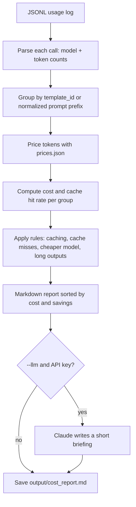

# token-cost-auditor

Turns LLM usage logs into a cost report: spend per prompt template, cache hit rates, and suggested fixes with estimated savings. Inspired by https://www.instagram.com/reel/DezWwy7P5hp/

## Quick start

```bash
git clone <this-repo> && cd token-cost-auditor     # Python 3.9+, no dependencies
cp .env.example .env                                # optional: set AUDIT_LOGS / ANTHROPIC_API_KEY
python3 auditor.py --demo                           # sample data, no keys needed
python3 auditor.py --logs path/to/usage.jsonl       # your own logs
python3 auditor.py --logs path/to/usage.jsonl --llm # plus a Claude-written briefing
python3 -m unittest discover -s tests               # run tests
```

Each log line is one API call. You can use the Anthropic response shape or flat fields:

```json
{"model": "claude-opus-5-5", "template_id": "support-bot", "prompt": "...", "usage": {"input_tokens": 6200, "output_tokens": 340, "cache_read_input_tokens": 0, "cache_creation_input_tokens": 0}}
```

`template_id` and `prompt` are both optional. With neither, the call is grouped as "(no prompt)".

## How it works

1. **Read the log.** Each line is one API call. The tool keeps the model name and four token counts: normal input, output, cache writes, and cache reads.
2. **Group by prompt template.** If a call has a `template_id`, that is its group. If not, the tool takes the start of the prompt and replaces the parts that change between calls (numbers, emails, URLs, IDs, quoted text) with placeholders. Calls made from the same template then end up in the same group.
3. **Price every call.** Each token count is multiplied by that model's price from `prices.json`, then the results are added up per group.
4. **Measure caching.** The cache hit rate is the share of prompt tokens that were read from the cache instead of paid for at full price.
5. **Apply simple rules to find fixes:**
   - Large, repeated prompts with no caching → turn on prompt caching (estimated saving shown).
   - Cache written more often than read → something at the start of the prompt changes every call, so the cache never gets reused.
   - Small inputs and outputs on an expensive model → try the cheaper model set in `prices.json` (saving shown).
   - Very long outputs → lower `max_tokens` or ask for a shorter format.
6. **Write the report.** Groups are sorted by cost, fixes by estimated saving, and the result is saved to `output/cost_report.md`.
7. **Optional briefing.** With `--llm`, Claude gets only the aggregated report (never your raw prompts) and writes a 5-bullet summary for the team lead.



## Configuration

| Env var | What it is | Where to get it |
|---|---|---|
| `AUDIT_LOGS` | Path to your JSONL usage log (same as `--logs`) | Export from your app's logging, or log the `usage` field of each API response |
| `AUDIT_PRICES` | Price table file, USD per 1M tokens (default `prices.json`) | Copy current prices from https://www.anthropic.com/pricing. The bundled values are examples only |
| `AUDIT_OUT` | Where the report is written (default `output/cost_report.md`) | Any path you like |
| `ANTHROPIC_API_KEY` | Only needed for `--llm` | https://console.anthropic.com/settings/keys |
| `AUDITOR_MODEL` | Model that writes the briefing (default `claude-opus-5-5`) | https://docs.anthropic.com/en/docs/about-claude/models |
